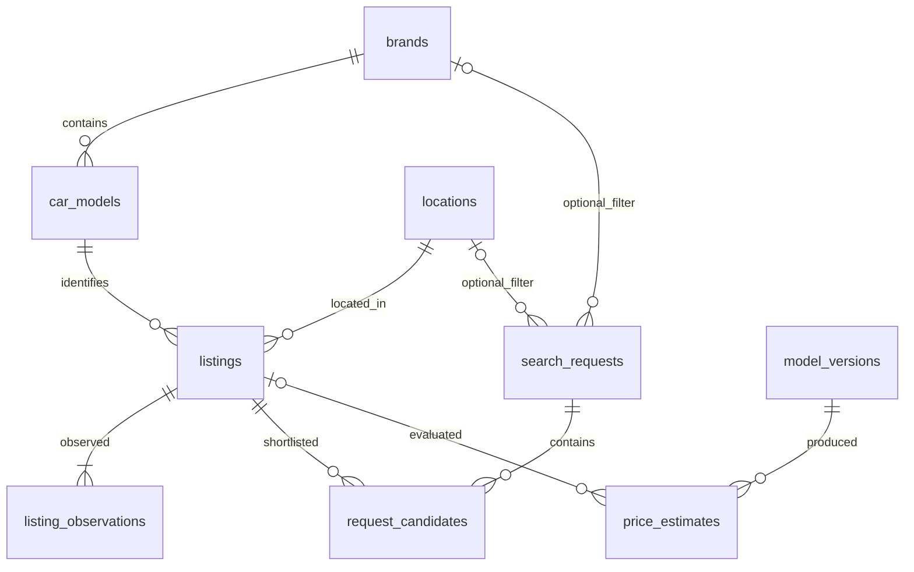

# Автоподбор


Помощник покупателя: требования и бюджет → подходящие объявления → сохранённые
кандидаты → сравнение цены объявления с ML-прогнозом. Учебный проект ИТМО,
«Разработка на Python и инженерия данных». Регистрации нет.

**Данные исторические, май–июнь 2023 года.** Прогнозируется цена предложения,
не сделки. Доступность, состояние машины и выгодность покупки не подтверждаются.

## Возможности и стек

Каталог с фильтрами/сортировкой/пагинацией, CRUD заявок, подбор по обязательным
ограничениям, кандидаты и сравнение, переходы статусов, версии моделей,
одиночные и CSV-предсказания, потоковый ETL, SQL-аналитика.

Python 3.12+, uv 0.13+, FastAPI, Pydantic, SQLAlchemy 2, PostgreSQL 17, Alembic,
pandas/Parquet, scikit-learn, CatBoost, pytest, HTML/CSS/JavaScript.
SQLite с внешними ключами поддерживается для локальной разработки.

```text
src/research_graph/
  api/          # HTTP и зависимости
  models/       # SQLAlchemy
  services/     # бизнес-правила, аналитика, сохранение оценок
  storage/      # подключение к БД
  pipelines/    # ETL и demo-seed
  ml/           # выборка, обучение, безопасные модели
  web/          # клиент собственного API
  schemas.py    # контракты создания/обновления/ответа
  cli.py        # команды rg
migrations/     # единственный способ создания и изменения схемы
tests/          # изолированные БД, API, ETL, ML, CLI
docs/           # план, метрики, сценарий защиты
```

## Локальный запуск

Из корня репозитория:

```bash
uv sync --locked
uv run rg migrate
uv run rg seed
uv run rg serve
```

[Интерфейс](http://127.0.0.1:8000), [Swagger](http://127.0.0.1:8000/docs).
Seed — **150 синтетических примеров**, помеченных в карточках; повторный запуск
без дубликатов. Они не использовались для опубликованного ML-эксперимента.
Без модели каталог/заявки работают, прогноз возвращает `409 model_not_loaded`.

## Docker Compose

```bash
docker compose up --build -d
docker compose ps
docker compose logs app
```

Интерфейс: [localhost:8000](http://127.0.0.1:8000). PostgreSQL не публикует порт,
хранит БД в именованном томе. Приложение автоматически выполняет миграции и
идемпотентный demo-seed. Модель подключается из `./artifacts/model.zip`.
Сырые данные не включаются в образ; обучение выполняется на хосте.

После подготовки выборки можно импортировать реальные объявления:

```bash
docker compose cp data/training.catalog.csv app:/app/data/catalog.csv
docker compose exec app uv run --no-sync rg import-data data/catalog.csv --limit 5000
```

`docker compose down` останавливает приложение, сохраняя БД.

## Данные и обучение

[Car Sales / eKiBee, Kaggle](https://www.kaggle.com/datasets/ekibee/car-sales-information/data),
версия 14, CC0. Источник — почасовые наблюдения первых ста страниц объявлений
по регионам. Исчезновение из сбора не подтверждает продажу.

```bash
uv run rg download-data
uv run rg prepare-data data/raw/all_regions.csv --size 50000 --seed 42
uv run rg train --threads 6 --iterations 800
uv run rg import-data data/training.catalog.csv --limit 5000
uv run rg serve
```

Около 400 MB ZIP и 2 GB CSV. Для подготовки нужна дополнительная временная
SQLite на диске; весь CSV не загружается в DataFrame. Уже скачанный файл можно
поместить в `data/raw/all_regions.csv` и пропустить скачивание.

Этапы: очистка типов, пропусков и некорректных диапазонов → последнее наблюдение
каждого ID → детерминированная равномерная hash-выборка → train/validation/test
60/20/20 с seed=42. Одно объявление не попадает в разные части.

Признаки: марка, модель, город, кузов, топливо, коробка, год, пробег, мощность,
объём двигателя. URL, ID, цена и текст исключены. Цвет и подробные комплектации
отложены для ограничения сложности: это инженерный отбор, а не доказательство
их бесполезности. `date` не используется, поскольку его семантика отдельно
не подтверждена. Допустимые дорогие/редкие машины сохраняются; неверные
диапазоны отклоняются, ошибки приведены также по ценовым сегментам.

Ridge: one-hot, масштабирование чисел, индикаторы пропусков; словарь только
по train. CatBoost: категории и числовой маркер пропусков, depth=6,
до 800 итераций, early stopping на validation. Выбор по validation MAE,
однократная итоговая оценка на test. Обучение отдельно от API.

По умолчанию 6 потоков CPU, GPU не используется. `used_ram_limit=4gb`
CatBoost — мягкая подсказка библиотеке, не жёсткий лимит всего процесса.

Выходные файлы:

- `data/training.parquet`, `data/training.catalog.csv`: выборка для ML и ETL;
- `data/training.json`: статистика подготовки;
- `artifacts/model.zip`: модель и метаданные;
- `artifacts/model.json`: метрики;
- `artifacts/model.splits.json`: ID для аудита split.

Сырые данные, локальные БД и модели исключены из Git.

### Первый эксперимент

1 294 757 строк → 945 717 уникальных объявлений → выборка 50 000.
Обучение/оценка: 90 секунд на Core Ultra 9 285H, 6 потоков; время одного запуска.

| Модель | Validation MAE, ₽ | Validation RMSE, ₽ |
|---|---:|---:|
| Ridge | 536 213 | 1 143 698 |
| CatBoost | 342 454 | 889 645 |

Выбран CatBoost. На независимом test (10 000): **MAE 334 061 ₽, RMSE 765 823 ₽**.
Базовая медианная оценка: test MAE 1 027 323 ₽.

| Ценовой сегмент | Объявлений на test | MAE, ₽ |
|---|---:|---:|
| До 500 тыс. | 2 985 | 137 526 |
| 500 тыс. — 1,5 млн | 3 956 | 227 238 |
| 1,5–5 млн | 2 738 | 466 120 |
| От 5 млн | 321 | 2 351 730 |

[Полный отчёт](docs/ml_results.json). Случайное разделение оценивает обобщение
внутри исторического периода, не перенос в будущее. Перепубликации машины
с разными ID не распознаются. Ошибка сегмента не является гарантией ошибки
для конкретного автомобиля; вероятностный интервал не рассчитывается.

## Бизнес-правила

1. Подбор соблюдает все ограничения. Неизвестный год/пробег не удовлетворяет
   соответствующему числовому ограничению.
2. Несоответствующий автомобиль или повторный кандидат — 409.
3. Закрытую заявку нельзя редактировать/удалять или менять её кандидатов;
   сначала требуется повторное открытие.
4. Изменение требований увеличивает ревизию; прежние кандидаты помечаются
   устаревшими. Переименование само по себе ревизию не меняет.
5. Статусы меняются специальными операциями; повторный переход — 409.
6. Каждая оценка сохраняет признаки, версию модели и необязательную связь с машиной.
7. Повторное наблюдение `(listing_id, observed_at)` пропускается; старые
   наблюдения не перетирают новые характеристики. ETL фиксирует пакеты;
   после сбоя можно безопасно повторить запуск.
8. Отклонение = `(цена − прогноз) / прогноз × 100%`. Аналитика учитывает только
   последнюю оценку каждой машины, чтобы повторные нажатия не искажали отчёт.

## ERD



M:N — заявки/объявления через кандидатов. UNIQUE: марки/города, модель в марке,
ID источника, наблюдение, пара заявка–машина. CHECK: цены, бюджеты, диапазоны,
статусы. Индексы: внешние ключи, дата, цена, год/пробег, статус.
Схема создаётся только Alembic, downgrade проверяется на тестовой БД.
[Полная ERD с полями](docs/erd.mmd).

```bash
uv run alembic upgrade head
uv run alembic check
```

## REST API

Полные ограничения и формы загрузки — [Swagger](http://127.0.0.1:8000/docs).

| Метод | Путь | Назначение |
|---|---|---|
| GET | `/api/health`, `/api/reference` | Состояние БД, справочники |
| GET | `/api/listings`, `/api/listings/{id}` | Каталог / объявление |
| GET / POST | `/api/requests` | Список / создание |
| GET / PUT / DELETE | `/api/requests/{id}` | Чтение / полная замена / удаление |
| POST | `/api/requests/{id}/close`, `/reopen` | Статусы |
| POST | `/api/requests/{id}/match` | Подбор по ограничениям |
| GET / POST | `/api/requests/{id}/candidates` | Подборка / добавление |
| DELETE | `/api/requests/{id}/candidates/{candidate_id}` | Удаление кандидата |
| POST | `/api/listings/{id}/estimate` | Прогноз и отклонение |
| GET | `/api/analytics/prices`, `/deviations` | SQL-отчёты |
| GET | `/api/model` | Версия, период, метрики |
| POST | `/upload-model` | Собственный ZIP до 50 MiB |
| POST | `/predict` | Массив 1–1000 машин |
| POST | `/predict-from-csv` | CSV до 1000 строк / 5 MiB |

```bash
curl -X POST http://127.0.0.1:8000/api/requests \
  -H 'Content-Type: application/json' \
  -d '{"title":"Городская машина","budget":1500000,"min_year":2012}'
curl -X POST http://127.0.0.1:8000/api/requests/1/match
curl -X POST http://127.0.0.1:8000/predict \
  -H 'Content-Type: application/json' \
  -d '[{"brand":"Toyota","name":"Corolla","location":"Москва","year":2015,"mileage":100000}]'
```

В PowerShell — `curl.exe` либо Swagger. Подготовленный CSV:

```csv
brand,name,location,year,mileage,power,engine_displacement,body_type,fuel_type,transmission,price
Toyota,Corolla,Москва,2015,100000,122,1.6,Седан,Бензин,АКПП,1300000
```

Цена необязательна; при наличии цены у всех строк возвращаются MAE и RMSE.
Исходный CSV Kaggle также поддерживается, включая исходные ссылку и `parse_date`.
Архив модели содержит JSON и, для CatBoost, нативный `model.cbm`.
Pickle/pkl не принимается. Проверка выполняется до атомарной замены модели.

Единый формат ошибок:

```json
{"error":{"code":"request_closed","message":"Сначала откройте заявку повторно"}}
```

201 — создание, 204 — удаление, 400 — некорректная модель, 404 — объект
не найден, 409 — бизнес-конфликт, 422 — входные данные.

## Переменные окружения

`.env.example` → `.env`; окружение приоритетнее файла.

| Переменная | По умолчанию | Назначение |
|---|---|---|
| `RG_DATABASE_URL` | `sqlite:///data/app.db` | Подключение SQLAlchemy |
| `RG_DATA_DIR` | `data` | Данные |
| `RG_MODEL_PATH` | `artifacts/model.zip` | Модель |
| `RG_ML_THREADS` | `6` | От 1 до 16 потоков CPU |
| `RG_ENABLE_MODEL_UPLOAD` | `true` | Загрузка модели |
| `RG_LOG_LEVEL` | `INFO` | Уровень логов |
| `RG_LOG_FORMAT` | `text` | `text` / `json` |
| `RG_REQUEST_TIMEOUT` | `10` | Сохранённая настройка шаблона |
| `RG_MAX_CONCURRENCY` | `4` | Сохранённая настройка шаблона |
| `RG_GITHUB_TOKEN` | пусто | Приложению не нужен, сохранён из шаблона |
| `POSTGRES_PASSWORD` | `local-development-only` | Локальная БД Compose |

Логи CLI — stderr, результаты — stdout. Секреты маскируются.
Публичное размещение требует отдельной защиты доступа.

## Качество и процесс

```bash
uv run ruff check .
uv run ruff format --check .
uv run mypy
uv run pytest
uv run pre-commit run --all-files
```

Проверка интерфейса в Chromium (создаёт и удаляет одну тестовую заявку,
сохраняет скриншоты в `artifacts`):

```bash
uv run playwright install chromium
uv run python scripts/check_web.py http://127.0.0.1:8000
uv run python scripts/check_feedback.py http://127.0.0.1:8000
```

Для проверки нужен запущенный сервер с каталогом и загруженной моделью.
Вторая проверка задерживает ответы на 1,2 секунды, проверяет индикаторы,
сообщения о завершении, запрет повторной отправки и восстановление после ошибок.
CI также выполняет PostgreSQL-интеграцию и сценарий браузера на Docker Compose.

Тесты используют изолированные БД и настоящие миграции, проверяют ETL,
идемпотентность, ограничения, сервисы, негативные API-сценарии, оба алгоритма,
безопасные форматы, split и CLI. CI: Linux/Windows × Python 3.12/3.13,
линтер, mypy и покрытие ≥90%.

Разработка в feature-ветках и PR. Взаимное ревью одногруппником по заданию
обязательно: два своих PR с ревью, ревью двух PR коллеги. CI и самопроверка
его не заменяют. Защита main включена: актуальный зелёный CI, один внешний
Approve и разрешённые обсуждения обязательны, правило распространяется на администратора.
PR зависимы: [приложение](https://github.com/troublegale/research-graph/pull/1)
→ [упаковка](https://github.com/troublegale/research-graph/pull/2)
→ [проверка интерфейса](https://github.com/troublegale/research-graph/pull/3).
При последовательном слиянии используйте merge-коммиты и переназначайте базу
следующего PR на main, чтобы сохранить историю разработки.

- [План](docs/project_plan.md)
- [Метрики](docs/ml_results.json)
- [Результаты проверки](docs/validation.md)
- [Демонстрация](docs/demo.md)
- [Запросы на интерфейс](docs/prompts.md)
- [Отчёт лабораторной 1](docs/lab1_report.md)
